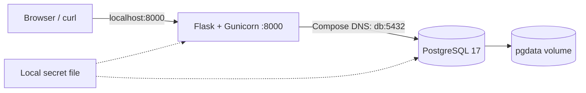

# Docker Lab — Notes + PostgreSQL

[English](README.en.md) | Português

Aplicação de notas com interface web em português/inglês, API Flask servida por Gunicorn e PostgreSQL, executada com Docker Compose. Demonstra build de imagem, rede entre serviços, secrets locais, healthchecks, volume persistente e recuperação de conexão.

## Iniciar

Pré-requisitos: Linux ou WSL, Docker Engine acessível ao usuário, Bash, Python 3, curl, Git e porta 8000 disponível. A primeira execução exige internet. Com Docker Desktop, habilite a integração WSL. O instalador local do Compose suporta Linux x86_64; em outra arquitetura, instale o plugin oficial antes.

```bash
git clone https://github.com/tommmdl/docker-lab.git
cd docker-lab
bash scripts/prepare.sh
bash scripts/compose.sh up -d --build --wait --wait-timeout 180
```

Abra **http://localhost:8000** e crie uma nota. O seletor de idioma altera a interface entre português e inglês. A API não possui autenticação neste laboratório; a porta é vinculada somente a localhost. O banco não publica porta no host.

`prepare.sh` gera uma senha aleatória em `.local/db-password` e preserva o arquivo em execuções seguintes. Se Compose não estiver instalado, baixa a versão oficial 5.6.0, verifica o SHA-256 e instala apenas dentro de `.local/`. O wrapper `compose.sh` funciona com o plugin global ou o plugin local. Segredos e binários locais são ignorados pelo Git e pelo contexto de build.

## Arquitetura



- A API conecta usando o DNS `db`, não `localhost`.
- `depends_on: service_healthy` aguarda o healthcheck do PostgreSQL antes de iniciar a API.
- `/healthz` indica que o processo responde; `/readyz` consulta o banco e a tabela para indicar prontidão. A saúde do container API usa `/readyz`.
- A aplicação abre conexões por operação e limita conexão/consulta por timeout. Uma falha de banco produz HTTP 503, e a próxima operação reconecta quando o banco volta.
- O volume `docker-lab_pgdata` mantém os dados após remover/recriar containers.
- A imagem da API roda com UID 10001, sistema de arquivos somente leitura, `/tmp` temporário e capabilities removidas.
- Imagens base são fixadas por digest; versões Python diretas e transitivas estão em `requirements.lock`. `requirements.txt` registra dependências diretas.

## API e uso

| Método | Rota | Resultado |
| --- | --- | --- |
| GET | `/` | Interface web bilíngue |
| GET | `/healthz` | 200: processo vivo |
| GET | `/readyz` | 200: pronto; 503: banco indisponível |
| GET | `/notes` | Até 100 notas, mais recentes primeiro |
| POST | `/notes` | 201: nota criada; 400: título inválido |
| DELETE | `/notes/<id>` | 204: excluída; 404: ausente |

O título deve ser uma string com 1–200 caracteres após remover espaços externos. O corpo da requisição é limitado a 4 KiB. Consultas SQL são parametrizadas, e a interface usa `textContent` para renderizar títulos.

```bash
curl -i http://localhost:8000/healthz
curl -i http://localhost:8000/readyz
curl -i -H 'Content-Type: application/json' \
  -d '{"title":"Aprendendo Docker / Learning Docker"}' http://localhost:8000/notes
curl http://localhost:8000/notes
# Replace 1 with the ID returned by POST
curl -i -X DELETE http://localhost:8000/notes/1
```

## Validação automatizada

```bash
python3 tests/integration.py
```

**Execute apenas neste laboratório local.** O teste cria/exclui notas próprias, recria os containers sem remover o volume e interrompe temporariamente o banco. Valida página HTML, CRUD, entradas inválidas, limite de corpo, SQL tratado como texto, persistência, HTTP 503 durante falha e recuperação sem reiniciar a API. A etapa de indisponibilidade usa `finally` para religar o banco. Os resultados ficam em `.local/integration-results.json`.

[Evidências reais e limites da validação](docs/validation.md).

## Operação e troubleshooting

```bash
bash scripts/compose.sh ps
bash scripts/compose.sh logs --tail=100 api db
bash scripts/compose.sh restart api
```

- `permission denied` no Docker: verifique acesso ao daemon e integração WSL. Neste ambiente gerenciado foi necessária execução autorizada fora do sandbox; não altere o socket para acesso público.
- Porta 8000 ocupada: ajuste a porta do host em `compose.yaml` e a URL em `tests/integration.py`.
- Banco unhealthy: consulte logs e espaço em disco; não apague o volume como primeira tentativa.
- Senha alterada com volume existente: a imagem PostgreSQL inicializa credenciais apenas em um volume novo. Alterar o arquivo local não rotaciona a senha no banco; preserve o original ou planeje a rotação de ambos.
- API unhealthy após falha de banco: religue `db` e aguarde a próxima verificação. `depends_on` ordena startup; não é um supervisor contínuo, e `restart: unless-stopped` não reinicia automaticamente um container só por estar unhealthy.

## Limpeza

```bash
bash scripts/compose.sh down
```

Preserva os dados. **`bash scripts/compose.sh down -v` apaga permanentemente as notas deste laboratório.** Não execute antes de salvar o que precisar. O arquivo local de senha permanece separado do volume.

## Decisões e limites

O foco é operação de containers. Não há autenticação de usuários, TLS, pool de conexões, paginação completa ou migrações versionadas. O bootstrap usa `CREATE TABLE IF NOT EXISTS` e não resolve mudanças futuras de esquema. O usuário `lab` criado pela imagem PostgreSQL tem privilégios administrativos: em produção, separe o usuário de migração do usuário de aplicação com privilégios mínimos. Compose secrets aqui são arquivos montados localmente, não um cofre criptografado. Persistência por volume não substitui backup. Os testes de interface verificam HTML servido, sem automação visual de navegador.

## Referências

- [Docker Compose startup order](https://docs.docker.com/compose/how-tos/startup-order/)
- [Compose secrets](https://docs.docker.com/compose/how-tos/use-secrets/)
- [PostgreSQL official image](https://hub.docker.com/_/postgres)
- [Psycopg installation](https://www.psycopg.org/psycopg3/docs/basic/install.html)
- [Portfolio](https://github.com/tommmdl/devops-portfolio)
