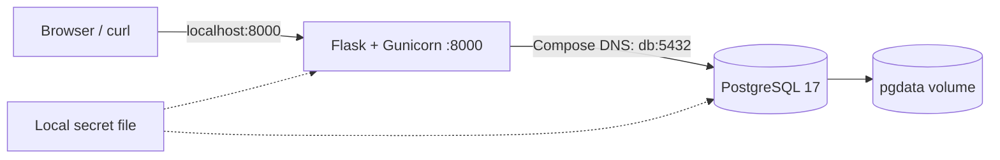

# Usage guide

[Português](guide.md) | [Back to the project](../README.en.md)

Run commands from the repository root.

## Start

Prerequisites: Linux or WSL, Docker Engine accessible to your user, Bash, Python 3, curl, Git and available port 8000. Initial startup needs internet. With Docker Desktop, enable WSL integration. Automatic local Compose installation supports Linux x86_64; install the official plugin beforehand on other architectures.

```bash
git clone https://github.com/tommmdl/docker-lab.git
cd docker-lab
bash scripts/prepare.sh
bash scripts/compose.sh up -d --build --wait --wait-timeout 180
```

Open **http://localhost:8000** and create a note. Use the language selector to switch between Portuguese and English. This lab API has no authentication; its published port binds only to localhost. The database has no published host port.

`prepare.sh` generates a random password in `.local/db-password` and preserves existing passwords. If Compose is missing, it downloads official version 5.6.0, verifies SHA-256 and installs it only within `.local/`. The `compose.sh` wrapper supports both global and local plugins. Local secrets and binaries are excluded from Git and the build context. On Linux, `.local/` uses host mode 0700; the password file uses 0644 so the non-root container UID can read the Compose bind mount. Permission isolation depends on the filesystem; DrvFS/Windows may apply different ACLs.

## Architecture



- The API connects using Compose DNS name `db`, not `localhost`.
- `depends_on: service_healthy` waits for PostgreSQL health before starting the API.
- `/healthz` checks process response; `/readyz` queries the database and table for readiness. The API container healthcheck uses `/readyz`.
- Each operation opens a connection with connection/query timeouts. A database failure returns HTTP 503; the next operation reconnects when the database returns.
- Volume `docker-lab_pgdata` preserves data across container removal/recreation.
- The API runs as UID 10001 with a read-only root filesystem, temporary `/tmp` and all capabilities dropped.
- Base images are pinned by digest; direct and transitive Python package versions are in `requirements.lock`. `requirements.txt` lists direct dependencies.

## API and usage

| Method | Route | Result |
| --- | --- | --- |
| GET | `/` | Bilingual web interface |
| GET | `/healthz` | 200: process alive |
| GET | `/readyz` | 200: ready; 503: database unavailable |
| GET | `/notes` | Up to 100 notes, newest first |
| POST | `/notes` | 201: created; 400: invalid title |
| DELETE | `/notes/<id>` | 204: deleted; 404: missing |

Titles must be strings of 1–200 characters after trimming. Request bodies are limited to 4 KiB. SQL statements are parameterized and the web UI renders titles using `textContent`.

```bash
curl -i http://localhost:8000/healthz
curl -i http://localhost:8000/readyz
curl -i -H 'Content-Type: application/json' \
  -d '{"title":"Aprendendo Docker / Learning Docker"}' http://localhost:8000/notes
curl http://localhost:8000/notes
# Replace 1 with the ID returned by POST
curl -i -X DELETE http://localhost:8000/notes/1
```

## Automated verification

```bash
python3 tests/integration.py
```

**Run only against this local lab.** The test creates/deletes its own notes, recreates containers without deleting the volume and temporarily stops the database. It checks served HTML, CRUD, invalid input, body size, SQL-like text handling, persistence, HTTP 503 during an outage and recovery without restarting the API. The outage section uses `finally` to restart the database. Results are saved in `.local/integration-results.json`.

[Actual evidence and verification limits](../docs/validation.en.md).

## Operations and troubleshooting

```bash
bash scripts/compose.sh ps
bash scripts/compose.sh logs --tail=100 api db
bash scripts/compose.sh restart api
```

- Docker permission denied: check daemon access and WSL integration. This managed environment required authorized commands outside the sandbox; do not make the socket publicly accessible.
- Port 8000 busy: change the host port in `compose.yaml` and test URL in `tests/integration.py`.
- Database unhealthy: inspect logs and disk capacity; do not delete the volume as the first troubleshooting step.
- Changed password with an existing volume: PostgreSQL image initialization only sets credentials on a new volume. Changing the local file does not rotate the database password; preserve the original or plan rotation on both sides.
- API unhealthy after a database outage: restart `db` and wait for the next check. `depends_on` controls startup, not continuous supervision; `restart: unless-stopped` does not automatically restart a container merely because it is unhealthy.

## Cleanup

```bash
bash scripts/compose.sh down
```

Preserves data. **`bash scripts/compose.sh down -v` permanently deletes this lab's notes.** Save anything needed first. The local password file remains separate from the volume.

## Decisions and limits

The focus is container operations. No user authentication, TLS, connection pool, complete pagination or versioned migrations. Bootstrap uses `CREATE TABLE IF NOT EXISTS` and cannot handle future schema changes. The image-created PostgreSQL `lab` user has administrative privileges; in production, separate migration and application users with least privilege. Compose secrets here are locally mounted files, not an encrypted vault. Volume persistence is not a backup. Interface tests check served HTML without visual browser automation.

## References

- [Docker Compose startup order](https://docs.docker.com/compose/how-tos/startup-order/)
- [Compose secrets](https://docs.docker.com/compose/how-tos/use-secrets/)
- [PostgreSQL official image](https://hub.docker.com/_/postgres)
- [Psycopg installation](https://www.psycopg.org/psycopg3/docs/basic/install.html)
- [Portfolio](https://github.com/tommmdl/devops-portfolio)
